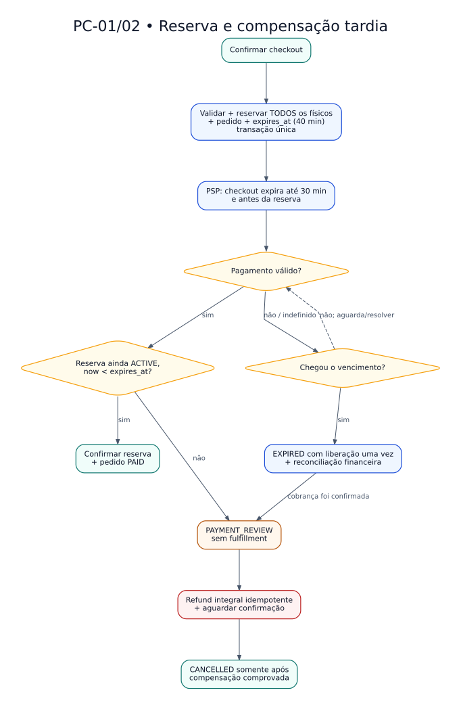

# PC-01/02 — Reserva e pagamento tardio

**Políticas:** [PC-01 / PC-02](../POLITICAS-CONSOLIDADAS.md) · **Regras:** RN-071–080.

[Fonte DOT](PC-01-reserva-e-pagamento-tardio.dot) · [SVG](PC-01-reserva-e-pagamento-tardio.svg) · [PNG](PC-01-reserva-e-pagamento-tardio.png)

Fluxograma conceitual, não BPMN executável. No ramo sem pagamento, se o encerramento externo for comprovado, o pedido pode ser cancelado sem refund. Ver [tabelas](../TABELAS-DE-TRANSICAO.md) para guardas.
