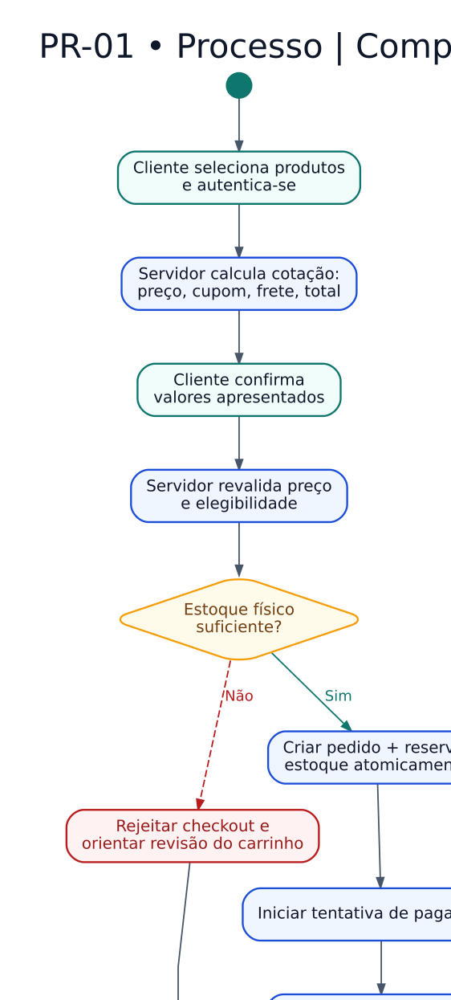

# PR-01 — Processo de compra física

> **Versão:** 0.1 (em revisão)  
> **Fase:** AC-MODEL-002  
> **Origem:** [BRD v0.1](../../02-business-requirements/REGRAS-DE-NEGOCIO.md)  
> **Regras:** RN-015–018, RN-023–028, RN-032–046, RN-055–057  
> **Capacidades:** RF-004–009

Reserva e snapshot são atômicos; pagamento assíncrono e revisão de inconsistência não podem vender estoque inexistente.

**Arquivos:** [Fonte editável `.dot`](PR-01-compra-fisica.dot) · [SVG](PR-01-compra-fisica.svg) · [PNG](PR-01-compra-fisica.png)  
**Voltar:** [Índice da Fase 02](../README.md)

## Limites e premissas

Este é um **modelo conceitual**, não comprova implementação, homologação de regras ou conformidade legal. Os ramos de exceção, as precondições e os efeitos colaterais serão especificados em contratos de domínio e testes de integração. Consulte as [decisões pendentes](../DECISOES-PENDENTES.md).
