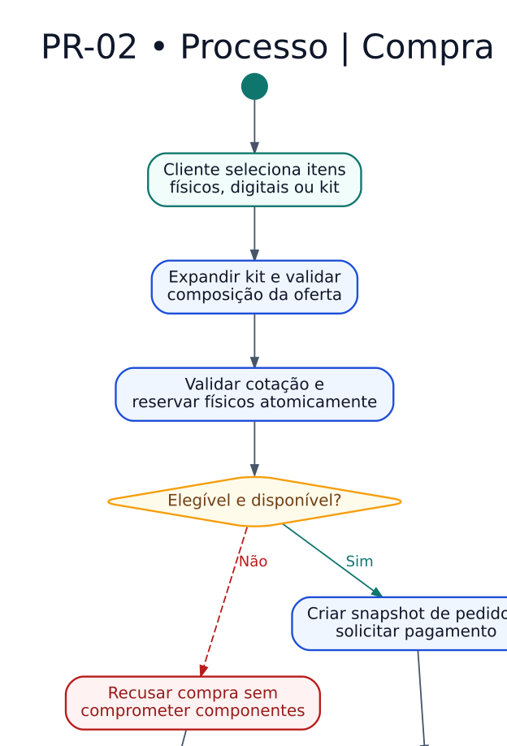

# PR-02 — Compra digital, física ou mista

> **Versão:** 0.1 (em revisão)  
> **Fase:** AC-MODEL-002  
> **Origem:** [BRD v0.1](../../02-business-requirements/REGRAS-DE-NEGOCIO.md)  
> **Regras:** RN-002, RN-007–008, RN-024, RN-030, RN-038, RN-049–055, RN-063  
> **Capacidades:** RF-005–010

Kits reservam componentes físicos de forma indivisível e direitos digitais exigem quitação e elegibilidade.

**Arquivos:** [Fonte editável `.dot`](PR-02-compra-digital-e-mista.dot) · [SVG](PR-02-compra-digital-e-mista.svg) · [PNG](PR-02-compra-digital-e-mista.png)  
**Voltar:** [Índice da Fase 02](../README.md)

## Limites e premissas

Este é um **modelo conceitual**, não comprova implementação, homologação de regras ou conformidade legal. Os ramos de exceção, as precondições e os efeitos colaterais serão especificados em contratos de domínio e testes de integração. Consulte as [decisões pendentes](../DECISOES-PENDENTES.md).
