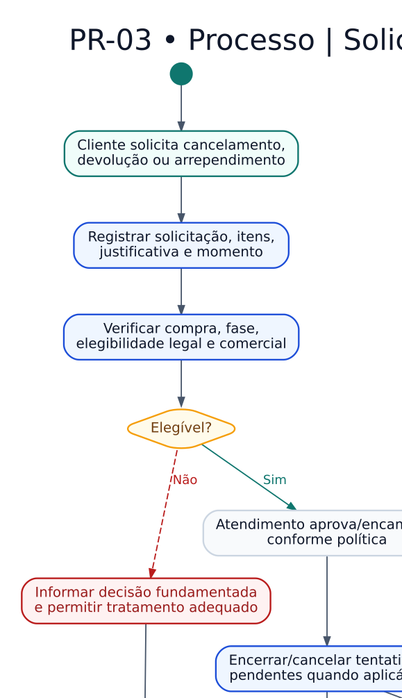

# PR-03 — Pós-venda, devolução e reembolso

> **Versão:** 0.1 (em revisão)  
> **Fase:** AC-MODEL-002  
> **Origem:** [BRD v0.1](../../02-business-requirements/REGRAS-DE-NEGOCIO.md)  
> **Regras:** RN-047–048, RN-054, RN-058–063, RN-065  
> **Capacidades:** RF-012

Estorno financeiro, reposição de estoque e revisão de direito digital são decisões distintas.

**Arquivos:** [Fonte editável `.dot`](PR-03-pos-venda-e-reembolso.dot) · [SVG](PR-03-pos-venda-e-reembolso.svg) · [PNG](PR-03-pos-venda-e-reembolso.png)  
**Voltar:** [Índice da Fase 02](../README.md)

## Limites e premissas

Este é um **modelo conceitual**, não comprova implementação, homologação de regras ou conformidade legal. Os ramos de exceção, as precondições e os efeitos colaterais serão especificados em contratos de domínio e testes de integração. Consulte as [decisões pendentes](../DECISOES-PENDENTES.md).
