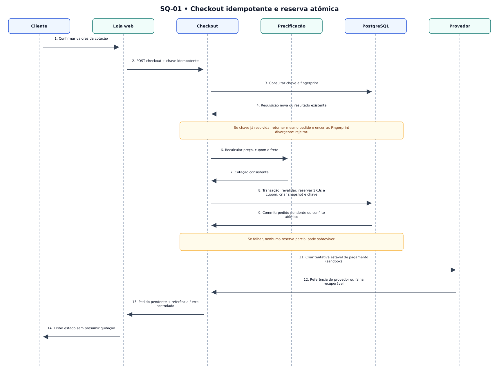
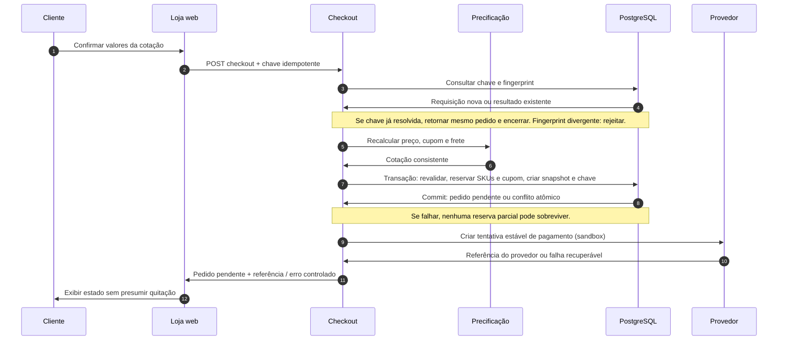

# SQ-01 — Checkout idempotente com reserva

> **Versão:** 0.1 (em revisão)  
> **Fase:** AC-MODEL-002  
> **Origem:** [BRD v0.1](../../02-business-requirements/REGRAS-DE-NEGOCIO.md)  
> **Regras:** RN-016–023, RN-025–028, RN-032–037  
> **Capacidades:** RF-005–008

Chaves idempotentes, atomicidade de reserva e criação do pedido; integração externa ocorre após o commit.

**Arquivos:** [Fonte editável `.mmd`](SQ-01-checkout-idempotente.mmd) · [SVG](SQ-01-checkout-idempotente.svg) · [PNG](SQ-01-checkout-idempotente.png)  
**Voltar:** [Índice da Fase 02](../README.md)

## Limites e premissas

Este é um **modelo conceitual**, não comprova implementação, homologação de regras ou conformidade legal. Os ramos de exceção, as precondições e os efeitos colaterais serão especificados em contratos de domínio e testes de integração. Consulte as [decisões pendentes](../DECISOES-PENDENTES.md).

## Mermaid (visualizável diretamente no GitHub)

