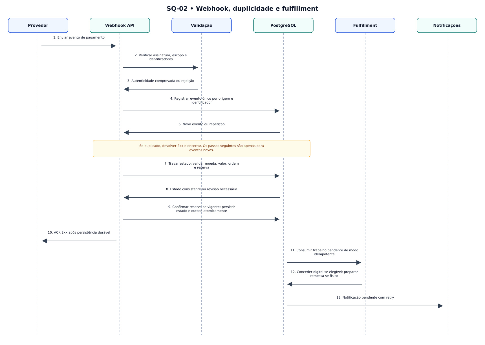

# SQ-02 — Webhook idempotente e fulfillment

> **Versão:** 0.1 (em revisão)  
> **Fase:** AC-MODEL-002  
> **Origem:** [BRD v0.1](../../02-business-requirements/REGRAS-DE-NEGOCIO.md)  
> **Regras:** RN-031, RN-041–050, RN-070  
> **Capacidades:** RF-007, RF-008, RF-010

Evento repetido é tratado sem reaplicação; confirmação de reserva e transição de pedido devem ser consistentes.



**Arquivos:** [Fonte editável `.mmd`](SQ-02-webhook-idempotente.mmd) · [SVG](SQ-02-webhook-idempotente.svg) · [PNG](SQ-02-webhook-idempotente.png)  
**Voltar:** [Índice da Fase 02](../README.md)

## Limites e premissas

Este é um **modelo conceitual**, não comprova implementação, homologação de regras ou conformidade legal. Os ramos de exceção, as precondições e os efeitos colaterais serão especificados em contratos de domínio e testes de integração. Consulte as [decisões pendentes](../DECISOES-PENDENTES.md).

## Mermaid (visualizável diretamente no GitHub)

```mermaid
sequenceDiagram
autonumber
participant G as Provedor
participant H as Webhook API
participant V as Validação
participant B as PostgreSQL
participant F as Fulfillment
participant N as Notificações
G->>H: Enviar evento de pagamento
H->>V: Verificar assinatura, escopo e identificadores
V->>H: Autenticidade comprovada ou rejeição
H->>B: Registrar evento único por origem e identificador
B->>H: Novo evento ou repetição
Note over H,B: Se duplicado, devolver 2xx e encerrar. Os passos seguintes são apenas para eventos novos.
H->>B: Travar estado; validar moeda, valor, ordem e reserva
B->>H: Estado consistente ou revisão necessária
H->>B: Confirmar reserva se vigente; persistir estado e outbox atomicamente
H->>G: ACK 2xx após persistência durável
B->>F: Consumir trabalho pendente de modo idempotente
F->>B: Conceder digital se elegível; preparar remessa se físico
B->>N: Notificação pendente com retry
```
