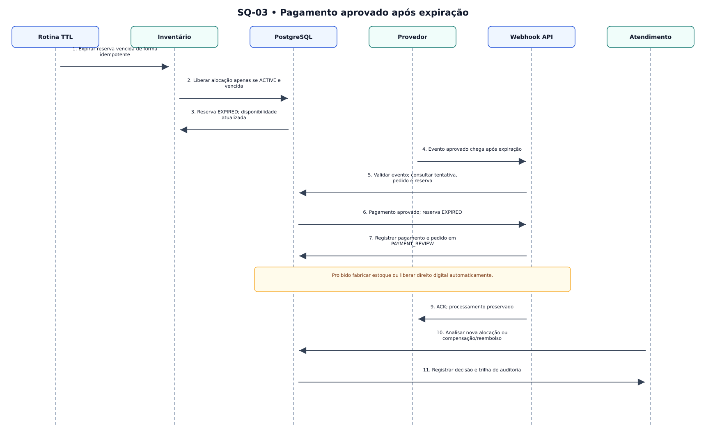

# SQ-03 — Pagamento aprovado após expiração

> **Versão:** 0.1 (em revisão)  
> **Fase:** AC-MODEL-002  
> **Origem:** [BRD v0.1](../../02-business-requirements/REGRAS-DE-NEGOCIO.md)  
> **Regras:** RN-027–028, RN-031, RN-043–046, RN-049  
> **Capacidades:** RF-007–009

Pagamento financeiro aprovado não implica que estoque ou direito digital possa ser concedido; caso entra em revisão.



**Arquivos:** [Fonte editável `.mmd`](SQ-03-pagamento-tardio.mmd) · [SVG](SQ-03-pagamento-tardio.svg) · [PNG](SQ-03-pagamento-tardio.png)  
**Voltar:** [Índice da Fase 02](../README.md)

## Limites e premissas

Este é um **modelo conceitual**, não comprova implementação, homologação de regras ou conformidade legal. Os ramos de exceção, as precondições e os efeitos colaterais serão especificados em contratos de domínio e testes de integração. Consulte as [decisões pendentes](../DECISOES-PENDENTES.md).

## Mermaid (visualizável diretamente no GitHub)

```mermaid
sequenceDiagram
autonumber
participant T as Rotina TTL
participant I as Inventário
participant B as PostgreSQL
participant G as Provedor
participant H as Webhook API
participant A as Atendimento
T->>I: Expirar reserva vencida de forma idempotente
I->>B: Liberar alocação apenas se ACTIVE e vencida
B->>I: Reserva EXPIRED; disponibilidade atualizada
G->>H: Evento aprovado chega após expiração
H->>B: Validar evento; consultar tentativa, pedido e reserva
B->>H: Pagamento aprovado; reserva EXPIRED
H->>B: Registrar pagamento e pedido em PAYMENT_REVIEW
Note over H,B: Proibido fabricar estoque ou liberar direito digital automaticamente.
H->>G: ACK; processamento preservado
A->>B: Analisar nova alocação ou compensação/reembolso
B->>A: Registrar decisão e trilha de auditoria
```
