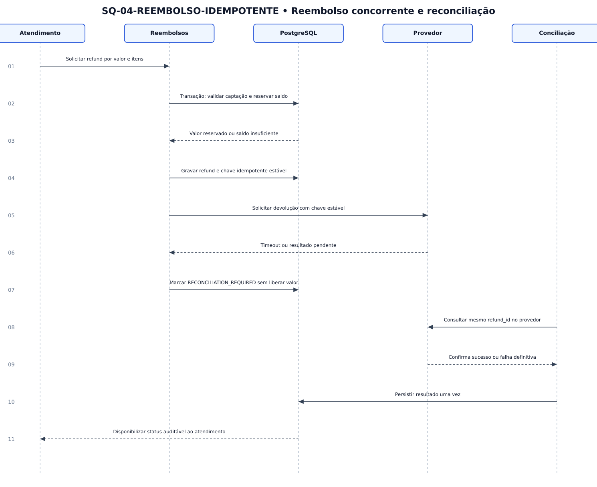
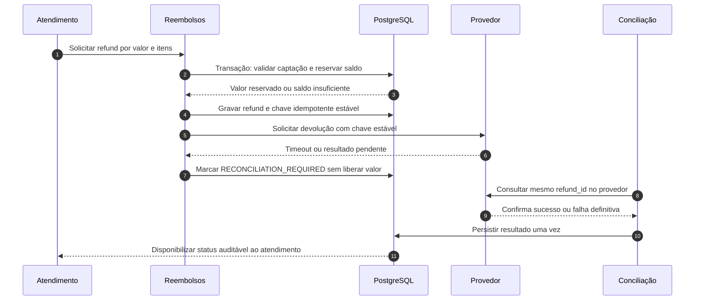

# SQ — Reembolso concorrente e reconciliação

> **Versão:** 0.2 — política revisada, não implementada.  
> **Fonte:** [Adendo v0.2](../../02-business-requirements/ADENDO-POLITICAS-CRITICAS-v0.2.md).

**Arquivos:** [Mermaid editável](SQ-04-reembolso-idempotente.mmd) · [SVG](SQ-04-reembolso-idempotente.svg) · [PNG](SQ-04-reembolso-idempotente.png).

## Fonte Mermaid

Sequência conceitual; guardas e exceções estão nas [tabelas de transição](../TABELAS-DE-TRANSICAO.md).
