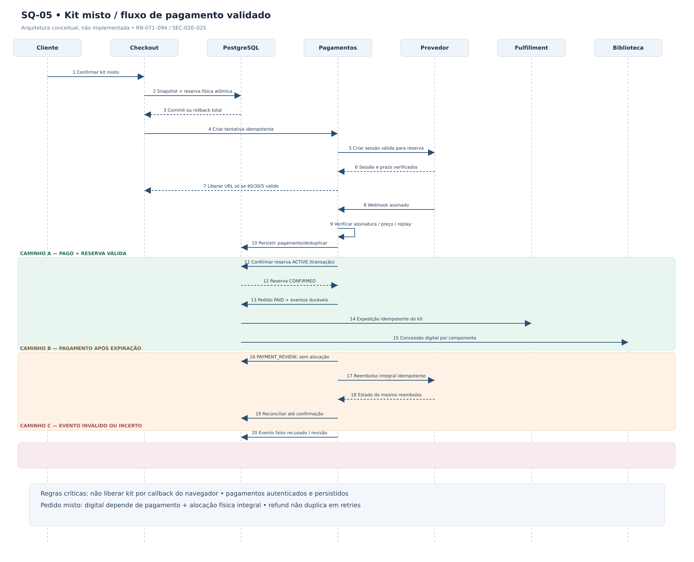

# SQ-05 — Checkout e fulfillment de kit misto (corrigido)

> **Versão:** 0.3.0 — modelo de Fase 02 corrigido, não implementado.  
> **Fontes:** [Adendo RN-071–094](../../02-business-requirements/ADENDO-POLITICAS-CRITICAS-v0.2.md), [PC-01–04](../POLITICAS-CONSOLIDADAS.md), [SEC-020–025](../../07-security/security-requirements.md).



**Arquivos:** [Mermaid](SQ-05-kit-misto.mmd) · [SVG](SQ-05-kit-misto.svg) · [PNG](SQ-05-kit-misto.png).

## Correção aplicada

O provedor de pagamento **não** confirma a compra diretamente para o Checkout. O módulo **Pagamentos** valida assinatura, vínculo ao pedido, valor, moeda e duplicidade, persiste o fato financeiro e só depois solicita a confirmação de reserva e pedido.

- A criação de sessão externa respeita a política **40/30/5**, condicionada à validação do PSP.
- A confirmação da reserva é atômica e depende de `ACTIVE` e de `now < expires_at` medido no PostgreSQL.
- Direitos digitais só são concedidos após quitação **e alocação integral dos físicos do kit**.
- Pagamento válido após expiração entra em `PAYMENT_REVIEW`, bloqueia expedição/direitos e inicia **reembolso integral idempotente**; resposta externa incerta exige reconciliação.
- Webhook inválido não libera mercadoria. Mesmo webhook duplicado não repete efeitos.

## Fonte Mermaid

```mermaid
sequenceDiagram
autonumber
actor C as Cliente
participant K as Checkout
participant B as PostgreSQL
participant G as Pagamentos
participant P as Provedor PSP
participant F as Fulfillment
participant D as Biblioteca
C->>K: Confirmar compra de kit misto
K->>B: Transacao: snapshot, pedido e reserva fisica atomica
B-->>K: Commit ou rollback integral do kit
K->>G: Criar tentativa persistida e idempotente
G->>P: Criar sessao (TTL PSP compativel com reserva)
P-->>G: ID e validade externa comprovados
G-->>K: URL somente apos validar janela 40/30/5
P->>G: Webhook assinado (evento possivelmente repetido)
G->>G: Validar assinatura, IDs, valor, moeda e replay
G->>B: Persistir evidencia financeira / deduplicar evento
alt Pagamento valido e reserva ACTIVE antes da expiracao
    G->>B: Confirmar toda reserva fisica com guarda atomica
    B-->>G: Reserva CONFIRMED (um unico vencedor)
    G->>B: Marcar pedido PAID + registrar intencoes duraveis
    B-->>F: Tarefa fisica idempotente por kit
    B-->>D: Concessao digital idempotente por componente
    F->>B: Remessa do kit completa ou excecao operacional
    D->>B: Direito por titular e componente auditado
else Pagamento valido e reserva EXPIRED ou RELEASED
    G->>B: Registrar PAYMENT_REVIEW; sem alocacao
    Note over G,D: Bloquear fulfillment e direitos digitais deste kit
    G->>P: Solicitar reembolso integral idempotente
    P-->>G: Resposta definitiva ou estado incerto
    G->>B: Conciliar mesmo refund ate prova de resultado
else Evento invalido, divergente ou nao conclusivo
    G->>B: Rejeitar evento falso ou sinalizar revisao
    Note over G,D: Nenhum direito digital ou entrega por callback isolado
end
```

Este diagrama é conceitual; o detalhamento de persistência, outbox e APIs será resolvido na Fase 03. As figuras SVG/PNG deste pacote representam o mesmo fluxo corrigido em formato de sequência simplificado, com ramificações identificadas.
