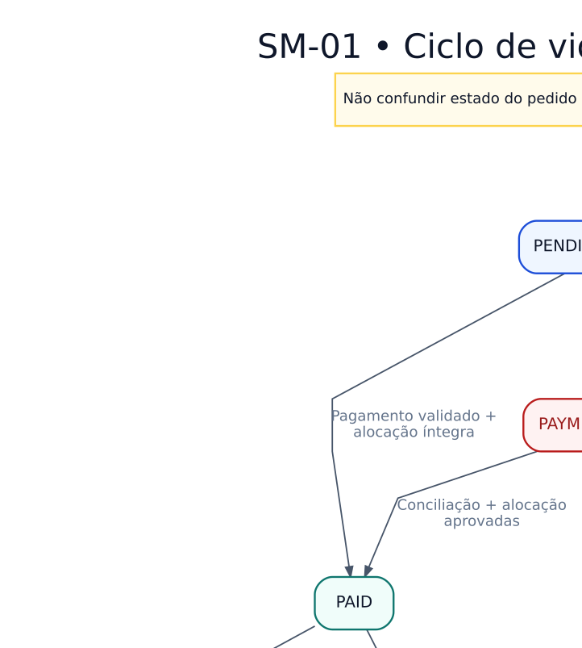

# SM — Estados comerciais do pedido

> **Versão:** 0.2 — políticas consolidadas (em revisão)  
> **Origem:** [Adendo de regras v0.2](../../02-business-requirements/ADENDO-POLITICAS-CRITICAS-v0.2.md)  
> **Regras:** RN-035, RN-046, RN-077–080, RN-084  
> **Estado:** modelo proposto, não implementado.

`PAYMENT_REVIEW` não indica reembolso concluído; `CANCELLED` após pagamento tardio depende de compensação integral comprovada. Reembolso de pedido já entregue é acompanhado no caso pós-venda, sem apagar entrega histórica.

**Arquivos:** [Fonte editável `.dot`](SM-01-pedido.dot) · [SVG](SM-01-pedido.svg) · [PNG](SM-01-pedido.png)  
**Guardas e efeitos:** [Tabelas de transição](../TABELAS-DE-TRANSICAO.md).  
**Voltar:** [Índice Fase 02](../README.md)

As setas representam transições de negócio; detalhes transacionais e implementação serão decididos na Fase 03.
