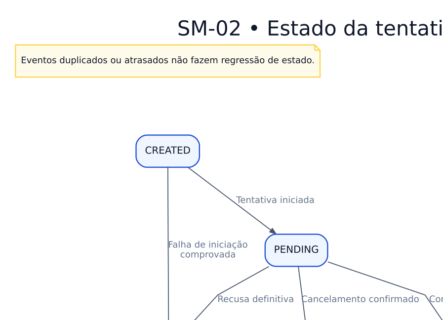

# SM-02 — Estados da tentativa de pagamento

> **Versão:** 0.1 (em revisão)  
> **Fase:** AC-MODEL-002  
> **Origem:** [BRD v0.1](../../02-business-requirements/REGRAS-DE-NEGOCIO.md)  
> **Regras:** RN-041–048  
> **Capacidades:** RF-007

Estados são da tentativa, não do pedido inteiro. Reembolso é registro/valor próprio além do estado simplificado.

**Arquivos:** [Fonte editável `.dot`](SM-02-tentativa-de-pagamento.dot) · [SVG](SM-02-tentativa-de-pagamento.svg) · [PNG](SM-02-tentativa-de-pagamento.png)  
**Voltar:** [Índice da Fase 02](../README.md)

## Limites e premissas

Este é um **modelo conceitual**, não comprova implementação, homologação de regras ou conformidade legal. Os ramos de exceção, as precondições e os efeitos colaterais serão especificados em contratos de domínio e testes de integração. Consulte as [decisões pendentes](../DECISOES-PENDENTES.md).
