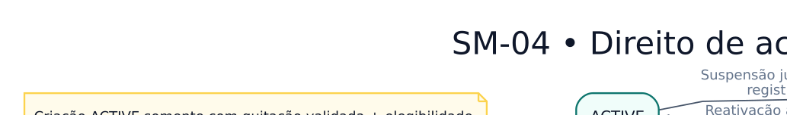

# SM-04 — Estados do direito digital

> **Versão:** 0.1 (em revisão)  
> **Fase:** AC-MODEL-002  
> **Origem:** [BRD v0.1](../../02-business-requirements/REGRAS-DE-NEGOCIO.md)  
> **Regras:** RN-014, RN-049–054  
> **Capacidades:** RF-010

O direito não é a URL temporária; alterações de publicação não revogam automaticamente compras anteriores.

**Arquivos:** [Fonte editável `.dot`](SM-04-direito-de-acesso-digital.dot) · [SVG](SM-04-direito-de-acesso-digital.svg) · [PNG](SM-04-direito-de-acesso-digital.png)  
**Voltar:** [Índice da Fase 02](../README.md)

## Limites e premissas

Este é um **modelo conceitual**, não comprova implementação, homologação de regras ou conformidade legal. Os ramos de exceção, as precondições e os efeitos colaterais serão especificados em contratos de domínio e testes de integração. Consulte as [decisões pendentes](../DECISOES-PENDENTES.md).
