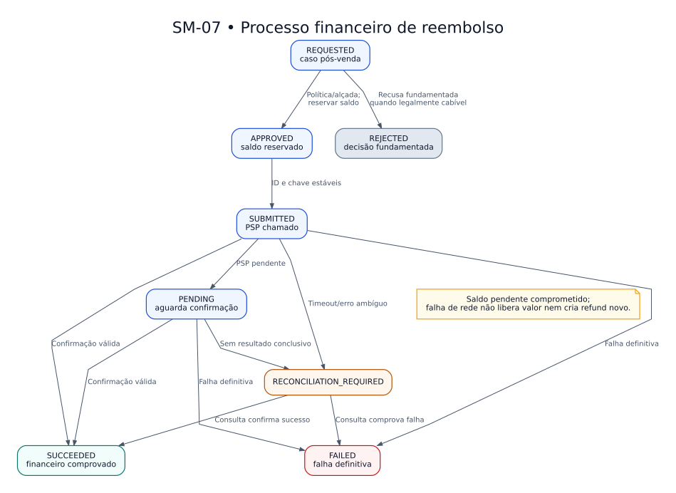

# SM — Máquina de estados do reembolso

> **Versão:** 0.2 — políticas consolidadas (em revisão)  
> **Origem:** [Adendo de regras v0.2](../../02-business-requirements/ADENDO-POLITICAS-CRITICAS-v0.2.md)  
> **Regras:** RN-047, RN-081–087  
> **Estado:** modelo proposto, não implementado.

Novo agregado conceitual independente da tentativa de pagamento. Aprovar compromete saldo em centavos; somente sucesso comprovado autoriza exibir reembolso concluído. Timeout deve ser conciliado com o mesmo ID, jamais reenviado como operação nova.

**Arquivos:** [Fonte editável `.dot`](SM-07-reembolso.dot) · [SVG](SM-07-reembolso.svg) · [PNG](SM-07-reembolso.png)  
**Guardas e efeitos:** [Tabelas de transição](../TABELAS-DE-TRANSICAO.md).  
**Voltar:** [Índice Fase 02](../README.md)

As setas representam transições de negócio; detalhes transacionais e implementação serão decididos na Fase 03.
