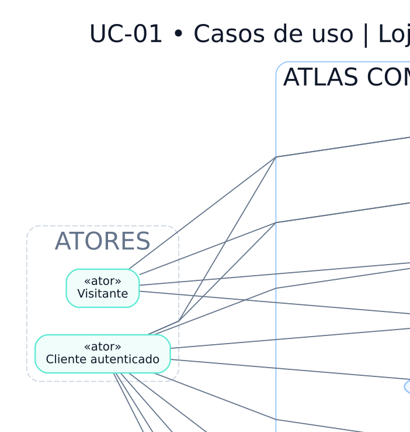

# UC-01 — Casos de uso da loja e do cliente

> **Versão:** 0.1 (em revisão)  
> **Fase:** AC-MODEL-002  
> **Origem:** [BRD v0.1](../../02-business-requirements/REGRAS-DE-NEGOCIO.md)  
> **Regras:** RN-001, RN-006, RN-009–015, RN-032–039, RN-049–053, RN-059  
> **Capacidades:** RF-001–006, RF-009–010, RF-012

Visitante pode pesquisar, visualizar prévias e manter carrinho; finalizar checkout exige autenticação.

**Arquivos:** [Fonte editável `.dot`](UC-01-loja-e-cliente.dot) · [SVG](UC-01-loja-e-cliente.svg) · [PNG](UC-01-loja-e-cliente.png)  
**Voltar:** [Índice da Fase 02](../README.md)

## Limites e premissas

Este é um **modelo conceitual**, não comprova implementação, homologação de regras ou conformidade legal. Os ramos de exceção, as precondições e os efeitos colaterais serão especificados em contratos de domínio e testes de integração. Consulte as [decisões pendentes](../DECISOES-PENDENTES.md).
