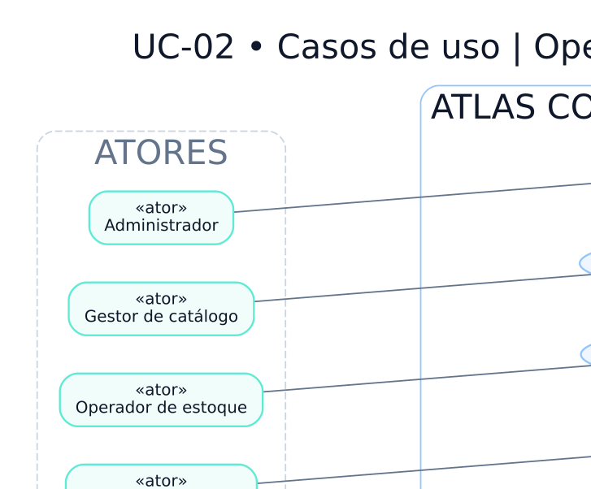

# UC-02 — Casos de uso do backoffice e integrações

> **Versão:** 0.1 (em revisão)  
> **Fase:** AC-MODEL-002  
> **Origem:** [BRD v0.1](../../02-business-requirements/REGRAS-DE-NEGOCIO.md)  
> **Regras:** RN-029, RN-039, RN-041–048, RN-059, RN-064–070  
> **Capacidades:** RF-007–008, RF-011–012

Os papéis são limitados por autorização; integração técnica não utiliza sessão humana.

**Arquivos:** [Fonte editável `.dot`](UC-02-backoffice-e-integracoes.dot) · [SVG](UC-02-backoffice-e-integracoes.svg) · [PNG](UC-02-backoffice-e-integracoes.png)  
**Voltar:** [Índice da Fase 02](../README.md)

## Limites e premissas

Este é um **modelo conceitual**, não comprova implementação, homologação de regras ou conformidade legal. Os ramos de exceção, as precondições e os efeitos colaterais serão especificados em contratos de domínio e testes de integração. Consulte as [decisões pendentes](../DECISOES-PENDENTES.md).
