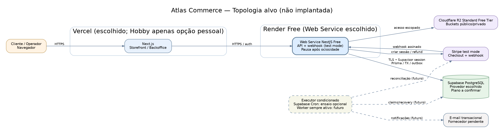

# Atlas Commerce — Topologia inicial Render Free + Supabase

> **Status:** desenho aprovado na escolha do provedor, não deploy implementado. Serviços e políticas descritos como proposta. A arquitetura efetiva depende de plano, região, segredos, hosts e banco definidos posteriormente.

**Fonte editável:** [DOT](IMPLANTACAO-RENDER.dot) · [SVG](IMPLANTACAO-RENDER.svg) · [PNG](IMPLANTACAO-RENDER.png).

## Componentes e fronteiras

| Componente | Provedor/status | Contrato |
|---|---|---|
| Next.js (storefront/admin) | **Vercel — direção aprovada** | Entrega UX e chama API via HTTPS; não acessa banco nem segredo Stripe |
| API NestJS | **Render Web Service Free — fornecedor/plano aprovados** | Módulos de domínio, autenticação/autorização, webhook validado, persistência de decisões |
| PostgreSQL | **Supabase PostgreSQL — provedor escolhido, plano pendente** | Fonte de verdade: pedidos, saldo, reservas, sessões, inbox/outbox, refunds, auditoria |
| Armazenamento | **Cloudflare R2 — direção aprovada** | Prévias públicas permitidas separadas dos originais privados; URL somente após entitlement |
| PSP | **Stripe Test Mode — selecionado** | Checkout hospedado, webhook assinado, refund e reconciliação pendentes de prova |
| Job dispatcher / reconciliador | **Serviço independente pendente de escolha** (Cron/Worker pagos ou alternativa explicitamente aprovada) | Expirar reservas, reprocessar outbox, conciliar Stripe, monitorar mensagens pendentes |
| Envio de e-mail | Fornecedor a escolher | Verificação de conta, reset e notificações, sem logar tokens |

## Ponto crítico: API suspensa não pode ser scheduler de negócio

Se o Web Service Render Free entrar em suspensão ou reiniciar, **o banco preserva os fatos**, mas jobs internos em memória param. A validade da reserva continua decidida por guardas no PostgreSQL. Mesmo que o job atrasar, pagamento tardio não pode reabrir uma reserva vencida; na próxima tentativa de confirmação, o backend usa relógio do banco, transições e reconciliação.

O **limite de 40 minutos** para reserva não autoriza prometer que a limpeza física será pontual caso o scheduler esteja parado. Para confiabilidade, escolher executor externo durável e plano compatível; registrar atrasos, retries e compensações.

## Segurança de borda e dados

- Render: HTTPS, segredos de serviço e `trust proxy` configurado após verificar roteamento real; health HTTP para readiness sem dados privados.
- Vercel: origem e cookies sob ADR-003. **Não presumir** que Vercel e `*.onrender.com` sejam same-site. Definir proxy/BFF ou CORS/CSRF antes de escrever autenticação.
- **Supabase PostgreSQL:** TLS, pool com limite, privilégios distintos por uso, Supavisor session 5432 ou direct IPv6 verificado, backup/export/restore; nenhum segredo de conexão no Next.js/browser. Supabase Auth e Storage **não foram escolhidos**.
- Stripe: assinatura `Stripe-Signature` no corpo original e persistência do recebimento antes do `2xx`; `200` não equivale a fulfillment processado.
- Cloudflare R2: endpoints privados no backend, URLs temporárias e validação de entitlement.

## Fontes relacionadas

[ADR-009](adrs/ADR-009-selecao-render.md) · [ADR-007](adrs/ADR-007-worker-e-jobs.md) · [ADR-008](adrs/ADR-008-controles-operacionais.md) · [baseline aprovada](BASELINE-ARQUITETURAL-APROVADA-v0.1.md) · [gates Render](VALIDACAO-OPERACIONAL-RENDER.md).

## Riscos específicos da combinação gratuita

- **Render Free:** pausa após 15 minutos sem tráfego, cold start cerca de 1 minuto, sem disco persistente/worker gratuito, SMTP de saída 25/465/587 bloqueado. Recebimento de webhook pode acordar API, mas não implica pontualidade/SLA.
- **Supabase Free (apenas recomendado):** risco de pausar projeto por baixa atividade e ausência de backups diários gerenciados como nos planos pagos. Se usado, exigir exportação lógica independente e restore testado; plano Free ainda depende de confirmação do responsável.
- **Transações:** estoque e direitos de cliente são sempre verificados no Supabase PostgreSQL. TTL 40/30/5, captura tardia e refund seguem guardas de DB, sem timers em memória como verdade.
- **Segurança:** Supabase serve somente como Postgres; identidade é NestJS e arquivos digitais são R2. Evitar expor tabelas transacionais ao Data API; proteger ou desabilitar a API quando não utilizada, sem depender de RLS como autorização principal do NestJS.

[ADR-010 Supabase](adrs/ADR-010-postgresql-supabase.md) · [Conexão](CONEXAO-RENDER-SUPABASE.md) · [Testes](VALIDACAO-OPERACIONAL-SUPABASE.md).

## Refinamento v0.4 — decisões confirmadas

- **Frontend Vercel** foi ratificado; Vercel Hobby é indicado **somente para portfólio pessoal não comercial**, conforme termos. Não representa deploy realizado ou plano selecionado explicitamente.
- **Cloudflare R2** é escolhido no **Free Tier Standard** (ver franquias e riscos na [ADR-005](adrs/ADR-005-midia-e-storage.md)); somente mídia licenciada, privados não expostos e links por entitlement.
- **Jobs**: o bloco tracejado é uma **capacidade operacional ainda não criada**. Supabase Cron pode ser ensaiado para transições SQL pequenas, mas não oferece, sem prova, SLA de expiração de reserva/Stripe. [ADR-007](adrs/ADR-007-worker-e-jobs.md).
- Render Free adormece; Supabase Free pode pausar (caso escolhido); a aplicação segue **demo sem venda real**.
