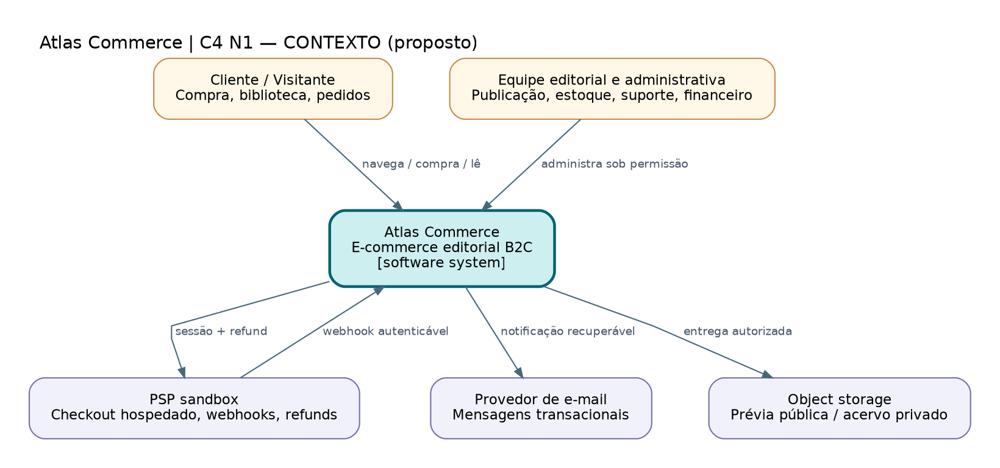

# C4-01 — Contexto do Atlas Commerce

> **Tipo:** C4: Nível 1 (contexto, notação visual adaptada) • **Estado:** proposta para revisão, não infraestrutura implementada.

**Fonte:** [DOT editável](C4-01-contexto.dot) · [SVG vetorial](C4-01-contexto.svg) · [PNG](C4-01-contexto.png). As três variantes correspondem ao mesmo arquivo DOT.

## Leitura do desenho

Apresenta atores humanos e sistemas externos, sem impor separação em microsserviços. O Atlas é uma plataforma de um vendedor; PSP, e-mail e storage são integrações sujeitas a contratos de segurança.

**Fluxos essenciais:** Cliente compra/acessa; equipe opera mediante autorização; PSP somente informa fatos financeiros após autenticação no backend.

**Rastreabilidade:** RN-001–094, SEC-001–038, DS-004/005/008.

**Limites:** O PSP não foi escolhido; storage e e-mail são papéis de sistemas externos, não fornecedores selecionados.
