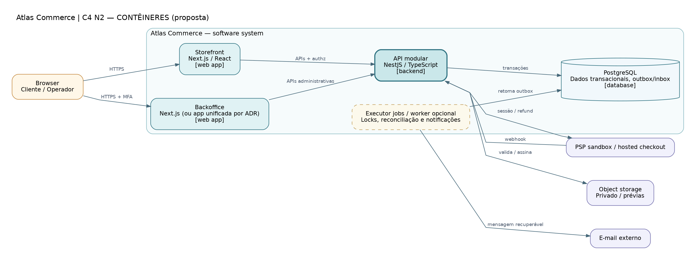

# C4-02 — Contêineres propostos

> **Tipo:** C4: Nível 2 (contêineres, notação visual adaptada) • **Estado:** proposta para revisão, não infraestrutura implementada.

**Fonte:** [DOT editável](C4-02-conteineres.dot) · [SVG vetorial](C4-02-conteineres.svg) · [PNG](C4-02-conteineres.png). As três variantes correspondem ao mesmo arquivo DOT.

## Leitura do desenho

Mostra duas interfaces hipotéticas, API modular NestJS e PostgreSQL transacional; um executor de tarefas é propositalmente opcional. A decisão de separar storefront/admin e de usar worker/fila depende de ADR.

**Fluxos essenciais:** Apenas API recebe webhooks; webapps não acessam DB/PSP secret/storage privado. DB armazena outbox/inbox; job executa efeitos recuperáveis.

**Rastreabilidade:** RNF-002/003/007/011, SEC-001–038, ADR-001/002/007.

**Limites:** A imagem é uma arquitetura proposta, não inventário de contêineres existentes. Redis/fila não aparecem porque ainda não estão aprovados.
