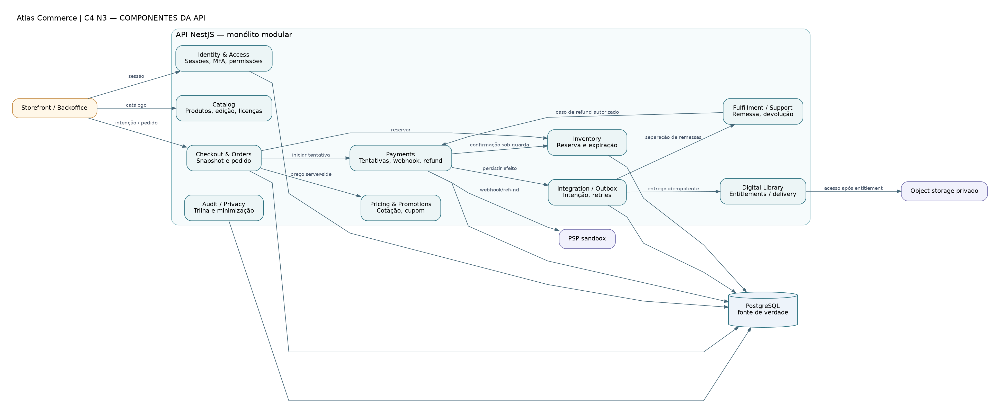

# C4-03 — Componentes lógicos da API

> **Tipo:** C4: Nível 3 (componentes/boundaries, notação visual adaptada) • **Estado:** proposta para revisão, não infraestrutura implementada.

**Fonte:** [DOT editável](C4-03-componentes.dot) · [SVG vetorial](C4-03-componentes.svg) · [PNG](C4-03-componentes.png). As três variantes correspondem ao mesmo arquivo DOT.

## Leitura do desenho

Fronteiras do monólito modular: responsabilidades claras e ownership de dados. As setas indicam contratos lógicos, não classes ou endpoints implementados.

**Fluxos essenciais:** Payments autentica PSP; Inventory aplica guardas; Orders controla pedido; Library exige pagamento e alocação física em kit; outbox recupera efeitos.

**Rastreabilidade:** RN-001–094; SEC-001–038; ADR-001/002/006.

**Limites:** Ilustração simplificada: autenticação e auditoria são transversais. As setas ao DB não implicam acesso direto de outros módulos à tabela de cada domínio.
