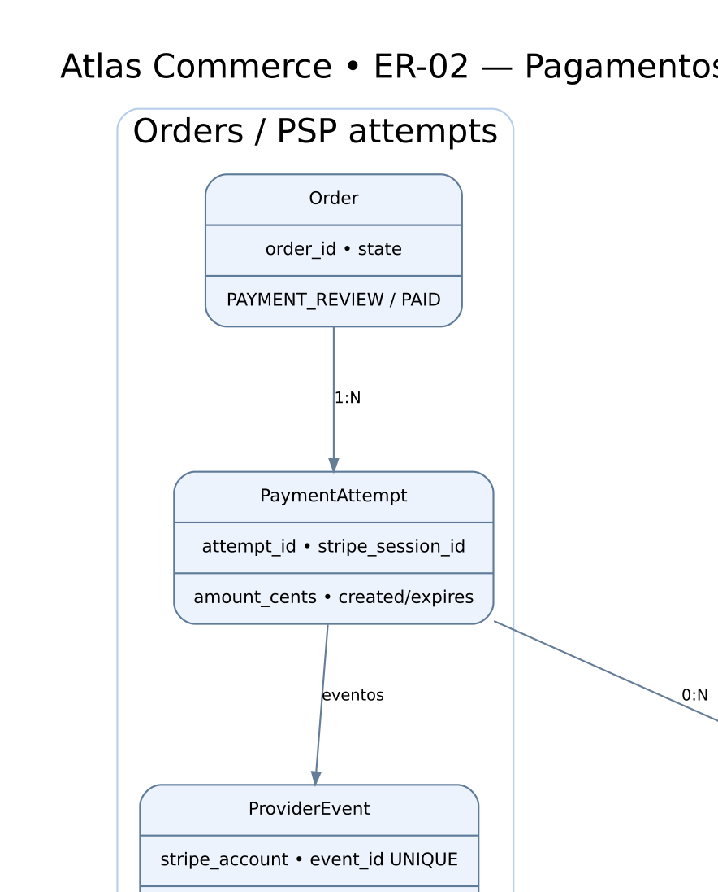

# ER-02 — Stripe, captura, refund, inbox/outbox e auditoria

> **Tipo:** modelo lógico **conceitual**, não schema físico nem DDL. Chaves/nomes são indicativos, sem migrations executadas.

**Fonte editável:** [DOT](ER-02-pagamentos-reembolsos.dot) · [SVG](ER-02-pagamentos-reembolsos.svg) · [PNG](ER-02-pagamentos-reembolsos.png).

Os vínculos representam ownership e referências lógicas; cardinalidades devem ser refinadas no schema e nos testes de constraint. **Regra de integridade:** nenhuma seta legitima bypass de autorização, gravar em tabela alheia sem contrato ou transação cruzada não definida. Ver [DB-01](DB-01-modelo-logico.md), [DB-02](DB-02-invariantes-e-locking.md), [ADR-006](../adrs/ADR-006-acesso-dados.md).
