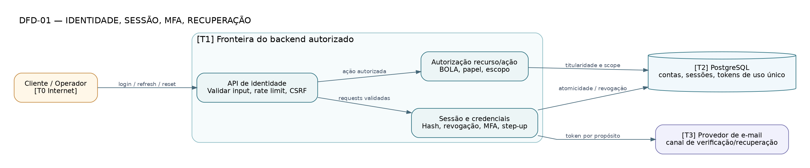

# DFD-01 — Identidade e sessão

> **Tipo:** Fluxo de dados e fronteiras T0/T1/T2/T3 (proposta) • **Estado:** proposta para revisão, não infraestrutura implementada.

**Fonte:** [DOT editável](DFD-01-identidade.dot) · [SVG vetorial](DFD-01-identidade.svg) · [PNG](DFD-01-identidade.png). As três variantes correspondem ao mesmo arquivo DOT.

## Leitura do desenho

Atores e cookies/tokens são não confiáveis na entrada; servidor concentra verificação de sessão, autorização de recursos, MFA e revogação; canal de e-mail não autoriza mudanças por si só.

**Fluxos essenciais:** Login/refresh/reset validam identidade; toda consulta privada passa por política de recurso; recovery possui token de uso único e sem enumeração.

**Rastreabilidade:** SEC-001–011, SA-001–004, TH-001/002/003/018.

**Limites:** Fluxo de cookies/CSRF e frequência/rate limit dependem do ADR-003. O DFD não homologa MFA nem fornecedor de e-mail.
