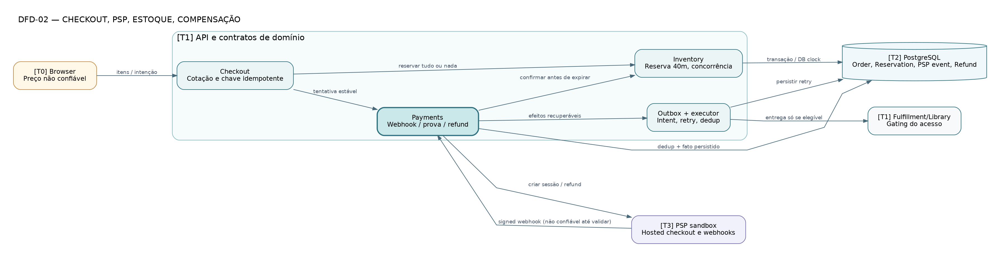

# DFD-02 — Checkout e pagamentos

> **Tipo:** Fluxo de dados T0–T3, controle de estados (proposta) • **Estado:** proposta para revisão, não infraestrutura implementada.

**Fonte:** [DOT editável](DFD-02-checkout-pagamento.dot) · [SVG vetorial](DFD-02-checkout-pagamento.svg) · [PNG](DFD-02-checkout-pagamento.png). As três variantes correspondem ao mesmo arquivo DOT.

## Leitura do desenho

Desenha browser não confiável, API transacional, PSP externo, PostgreSQL como verdade e despacho recuperável. Expiração/confirm/review são guardas do banco, não decisões derivadas do browser.

**Fluxos essenciais:** Browser não fixa preço; Checkout reserva; Payments valida webhook; outbox somente aciona entrega autorizada; pagamento tardio gera review/refund.

**Rastreabilidade:** RN-071–084, SEC-016–024, SA-005–008, TH-004–010.

**Limites:** PSP Stripe é candidato, não escolha; método de autorização de eventos/expiry exige contrato e ensaio real.
