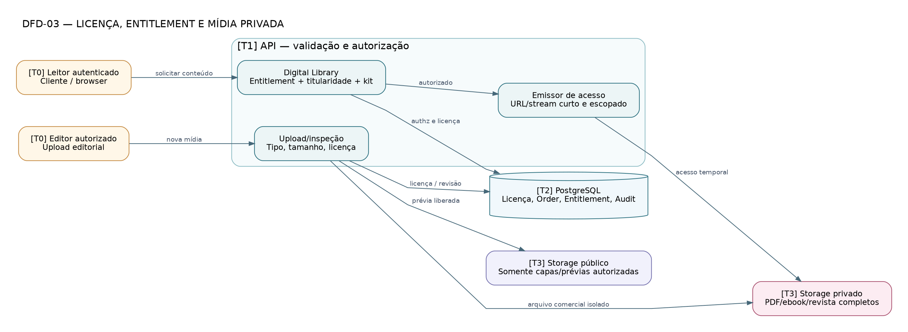

# DFD-03 — Distribuição de conteúdo digital

> **Tipo:** Fluxo de dados T0–T3: dados licenciados e armazenamento privado • **Estado:** proposta para revisão, não infraestrutura implementada.

**Fonte:** [DOT editável](DFD-03-entitlements.dot) · [SVG vetorial](DFD-03-entitlements.svg) · [PNG](DFD-03-entitlements.png). As três variantes correspondem ao mesmo arquivo DOT.

## Leitura do desenho

Separa editor/cliente, autorização de entitlement e mídias públicas/privadas. Direito de kit misto exige cobrança comprovada e reserva física integral confirmada.

**Fluxos essenciais:** Antes de emitir URL temporária, validar conta, recurso, licença, estado, compra e restrições. Upload não publica conteúdo integral por padrão.

**Rastreabilidade:** RN-049–054, RN-079/087/091, SEC-012–013/025–030, SA-009/010, TH-011–014.

**Limites:** Links temporários podem ser compartilhados até a expiração; não representam DRM nem exclusão jurídica de direitos.
