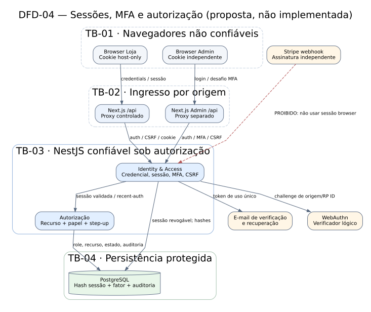

# DFD-04 — Fronteiras de confiança de sessão e MFA

> Modelo de ameaça inicial; **não constitui certificação** nem afirma controles implantados.

**Fonte e exportações:** [DOT](DFD-04-sessoes-mfa.dot) · [SVG](DFD-04-sessoes-mfa.svg) · [PNG](DFD-04-sessoes-mfa.png).

O diagrama separa navegador da loja, navegador administrativo, proxies por origem, NestJS, PostgreSQL, e-mail e verificação WebAuthn. A seta pontilhada Stripe é uma **proibição semântica**: integração PSP não herda cookie/CSRF de browser, e sim autenticação técnica própria no módulo Pagamentos. Ver [ADR-003](../adrs/ADR-003-autenticacao-sessoes.md), [contratos](../08-contratos-de-autenticacao.md) e [ameaças](threat-model.md).

Guards de login, MFA, recuperação, rotação, step-up e cache SSR serão verificados em AUTH-001–020. A topologia real de host/ingress ainda depende de aprovação; não desenhar subdomínios efetivos como se existissem.
