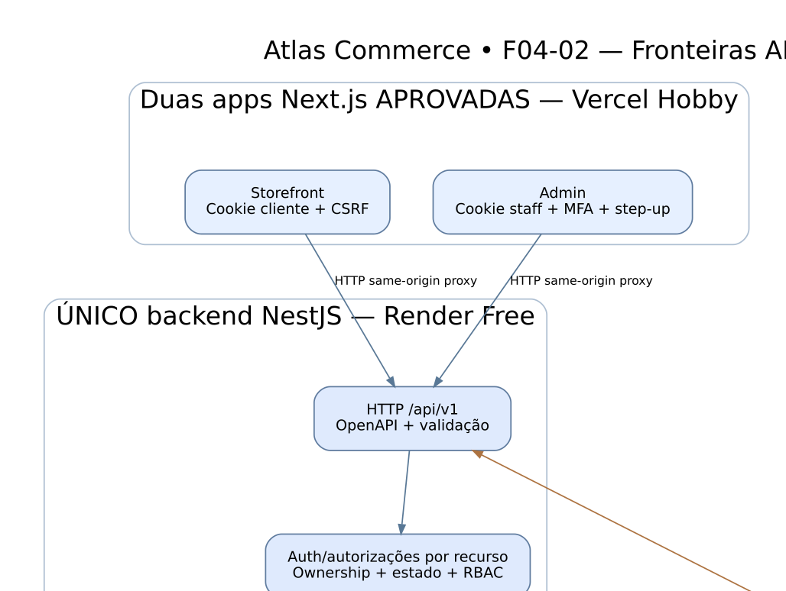

# API-01 — Três apps, contrato de API e verdade transacional

> **Diagrama conceitual documental**; infraestrutura Free e chamadas HTTP não foram provisionadas/implantadas/testadas. Apps separadas foram expressamente aprovadas; nomes de rotas e eventos são propostas F04-02.

**Fonte editável:** [DOT](API-01-fronteiras.dot) · [SVG](API-01-fronteiras.svg) · [PNG](API-01-fronteiras.png).

A seta Stripe→API representa webhook HTTPS direto com assinatura verificada antes de persistência. A seta módulo→Stripe representa chamada externa **após commit**, não dentro de TX aberta. O desenho não autoriza compartilhamento de cookie entre lojas/admin ou acesso Next.js direto ao DB/R2 com segredos.

[Contrato CT-01](../CT-01-inventario-http.md), [auth CT-04](../CT-04-sessoes-csrf-e-webhook.md), [eventos CT-05](../CT-05-eventos-duraveis.md).
