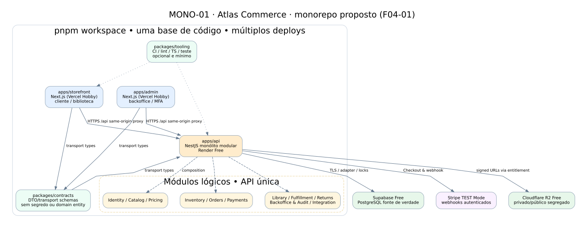

# MONO-01 — Estrutura proposta do monorepo e integração

> **Status:** blueprint de implementação, não diretórios realmente criados ou sistemas implantados. O desenho inclui duas apps Next.js separadas **como recomendação ainda sujeita a aceite**. O monólito NestJS é uma única API.

**Arquivos separados:** [DOT editável](MONO-01-workspaces.dot) · [SVG](MONO-01-workspaces.svg) · [PNG](MONO-01-workspaces.png).

**Leitura:** Next.js usa somente contratos de transporte do workspace; NestJS é dono de autenticação, regras e integrações; PostgreSQL é a fonte de verdade; Stripe opera em Test Mode e R2 mantém arquivos privados protegidos. As setas representam **fronteiras**, não módulos efetivamente implementados. O deploy Free não garante execução contínua de jobs. Ver [F04-01](../F04-01-estrutura-monorepo.md) e [F04-02](../F04-02-fronteiras-modulos.md).
