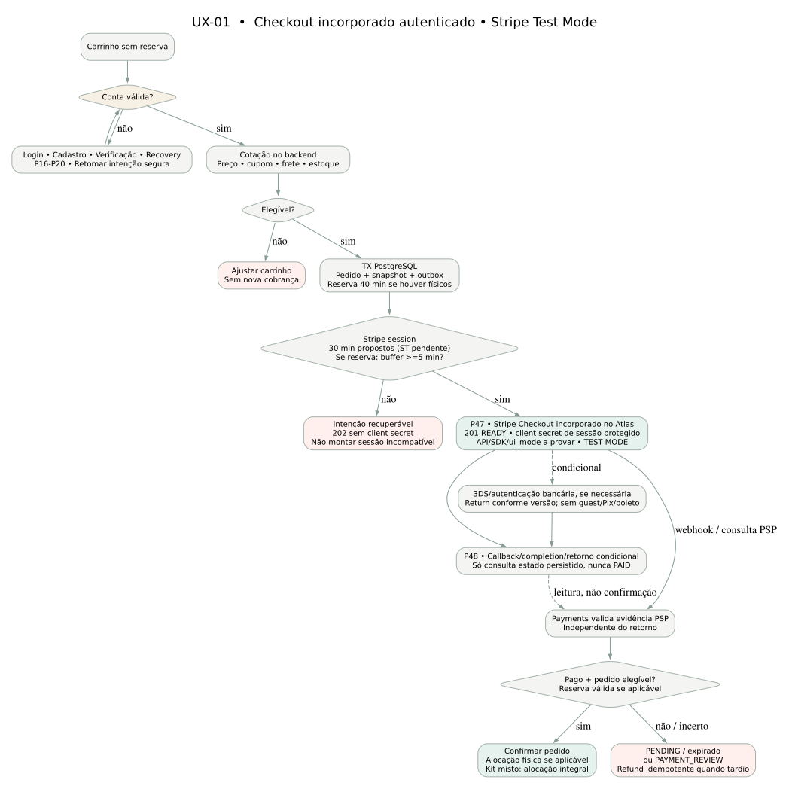

# UX-01-checkout-autenticado — checkout autenticado Stripe incorporado Test Mode

> **Direção de checkout incorporado aprovada; integração, contratos e testes permanecem propostos/não executados.** A fonte editável é [UX-01-checkout-autenticado.dot](UX-01-checkout-autenticado.dot).

[PNG separado](UX-01-checkout-autenticado.png). Não usar este diagrama como validação de implementação ou substituto de regras RN/PC/SEC.

**Leitura condicional:** RN-079/PC-02/04 dispensam reserva física no digital puro; a vigência comercial e a licença continuam obrigatórias. Nos pedidos com físicos, 40/30/5 segue ADR-004 e prova ST pendente. O retorno apenas consulta status; processamento PSP e persistência não dependem de retorno do navegador. Ver [jornada J02](../FD-03-02-jornadas-comerciais.md) e [pendências UXD-16/18](../FD-03-08-decisoes-abertas.md).

P47 monta o componente oficial Stripe mediante READY/client secret restrito; P48 acompanha estado. `202` não libera client secret. Completion, 3DS ou eventual return_url não provam PAID; `success_url` hosted não é proposto. API/SDK/ui_mode exatos seguem gate ST, sem valor executado nesta documentação. Ver [FD-03-11](../FD-03-11-checkout-stripe-incorporado.md), [UX-03](UX-03-stripe-incorporado.md) e [CT-10](../../contracts/CT-10-migracao-embedded-checkout-proposta.md).
