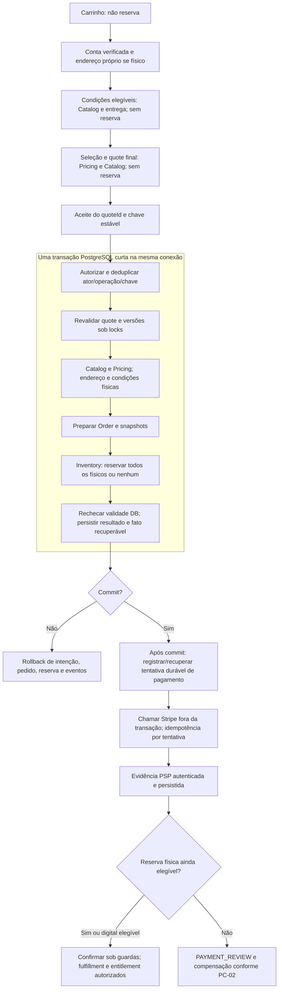

# QTE-POL-05 — Fluxo, evidências e matriz de decisões

**15/10/2026 · ratificação ADR-QTE recebida.** QTE-DEC-002/003/004/005/006/010
ratificados nos limites de [ADR-012 / ADR-QTE](../../04-architecture/adrs/ADR-012-politicas-cotacao-entrega-enderecos.md).
001/007 preservados; 008/009 continuam BLOQUEADOS. Sem implementação.

## Baseline e classificação — evidência histórica QTE-02

Inspeção: `main`, HEAD `d8b0fe21a2ea898245754d57662b14dbad5eb1a8`, árvore inicialmente
limpa. O [Quality 38794591141](https://github.com/Igor475/atlas-commerce/actions/runs/38794591141)
foi consultado nesta tarefa: `completed/success`, mesmo SHA, nove jobs aprovados:
checks, postgres, identity, catalog, pricing, inventory, orders, quote e int02
(nomes dos jobs de integração terminam em `-integration`). Isso comprova CI do
baseline publicado, **não** CI deste pacote novo nem homologação comercial.

| Classe                       | Constatação no HEAD                                                                                                   | Limite                                                                                                      |
| ---------------------------- | --------------------------------------------------------------------------------------------------------------------- | ----------------------------------------------------------------------------------------------------------- |
| Ratificação anterior         | DA-007: categoria simulador; UXD-16: campo obrigatório/anulável; Stripe incorporado Test Mode: apresentação escolhida | Não ratifica novas tarifas, TTL, DTOs ou compatibilidade SDK/API                                            |
| Regras/documentos existentes | RN-011/012, 015–023, 032–040, 055; PC-01–04; DB-01–05; CT-01/02/03/06/08/10                                           | Manter precedência e histórico; várias fontes se intitulam propostas, não promovê-las em bloco a RATIFICADO |
| Implementação técnica local  | Catalog/Pricing persistidos, Inventory/Orders/Quotes TEST_ONLY; emissão imutável e preparação atômica                 | Sem checkout comercial, endereço real, pagamento ou frete público habilitado                                |
| Prova histórica              | QTE-001–030 e ORD-001–036 documentados; CI do baseline passou                                                         | Nenhuma dessas suítes foi reexecutada por esta tarefa documental                                            |
| Propostas novas              | Tarifa fixa, Customer Profile, TTL 10 min, seleção e vínculo único comercial                                          | Todas **PROPOSTO**; dependem de aprovação antes de código/norma                                             |
| Bloqueios externos           | L1_SQL_STRICT, Identity comercial/origens/cookies, Stripe/40/30/5                                                     | Permanecem pendentes/não homologados; nenhuma conexão remota nesta entrega                                  |

O texto antigo de ADR-004 que chama UXD-16 de pendente é histórico superado
**somente nesse campo** pela [ratificação expressa](../contracts/UXD-16-RATIFICACAO-RESPONSAVEL.md)
e pela precedência registrada em CT-10. ADR, CT e OpenAPI não foram alterados.

## Índice incremental e diagnóstico

- [Entrega: alternativas, cálculo e recomendação](QTE-POL-01-politica-entrega-proposta.md).
- [Endereços: fronteira, titularidade e privacidade](QTE-POL-02-enderecos-e-titularidade.md).
- [TTL e revalidação](QTE-POL-03-ttl-e-revalidacao.md).
- [HTTP e deltas candidatos de OpenAPI](QTE-POL-04-contratos-http-propostos.md).

Lacunas confirmadas: opção vem do port servidor TEST_ONLY; QuoteResult não
expõe entrega estruturada; endereço possui somente zona/flags artificiais; TTL
comercial não está implementado; quote não é single-use comercial; Identity real e máquina
comercial de pedidos/pagamentos ainda não compõem esse fluxo. Não são falhas
que autorizem reescrever a fundação local nesta etapa.

Fontes examinadas: [CAT-01](../catalog/README.md), [PRIC-01](../pricing/README.md),
[INV-01](../inventory/README.md), [ORD-01](../orders/README.md),
[QTE-01](README.md), [DB-01](../../04-architecture/database/DB-01-modelo-logico.md),
[DB-02](../../04-architecture/database/DB-02-invariantes-e-locking.md),
[DB-03](../../04-architecture/database/DB-03-migrations-e-recuperacao.md),
[DB-04](../../04-architecture/database/DB-04-orm-drivers-pool.md),
[DB-05](../../04-architecture/database/DB-05-plano-de-validacao.md),
[inventário FD-03](../fd03/FD-03-03-inventario-telas-estados.md),
[inventário estendido](../fd03/FD-03-09-inventario-completo-paginas.md),
[plano FD-05](../fd05/FD-05-00-plano-de-mockups.md) e
[pilotos FD-05](../fd05/FD-05-01-roteiro-telas-piloto.md).
P08/P09/P11/P30/P47/P48/P49 continuam IDs UX, não endpoints ou telas entregues.
Conceito A e nove referências prioritárias são preservados; nenhum mockup,
token, logo ou ativo de terceiros foi criado/copiado.

## Fluxo transacional futuro — sem implementação

O diagrama é proposta de coordenação comercial; hoje `orders.prepare_quote`
chama `quotes.validate_for_preparation` e o coordenador ORD-01 dentro da mesma
transação, com binding/validação privados por XID, snapshots, reserva e evidência.
A [migration aditiva](../../../apps/api/prisma-quotes-ports/orders/migrations/202610150011_quote_preparation/migration.sql)
impede que intenção nova desvie da revalidação pelo port legado. A
[migration Quotes](../../../apps/api/prisma-quotes/migrations/202610150010_quote/migration.sql)
compara snapshots e prazo após locks; os
[testes QTE](../../../apps/api/test/quotes/quotes.integration.ts) e
[ORD](../../../apps/api/test/orders/orders.integration.ts) fornecem provas locais
históricas. Schemas Prisma são projeções; não substituem constraints/ACLs SQL.

Emissão da quote é transação anterior independente **sem reserva**, o que é válido.
Não separar commits de preparação Orders e reserva Inventory. Endereço, política,
preços e composição precisam de validação coerente na transação final; nova
política externa deve chegar como evidência pré-obtida/versionada, sem I/O HTTP
sob lock. Digital pula entrega e reserva. A origem de verdade do preço é Pricing;
Catalog decide publicação/composição, não disponibilidade financeira.

Depois do commit, PC-01 prevê iniciar tentativa: persistir identidade/intenção
recuperável de PaymentAttempt em transação local antes de chamar Stripe, vinculada
unicamente ao pedido/tentativa. Se o processo cair entre os commits, recuperar
pela intenção/fato durável da preparação. Outbox/consumidor comercial ainda
precisam de desenho/testes aprovados; evento técnico existente não é dispatcher
implementado. Nenhum client secret antes de comprovar sessão elegível.

Pagamento aprovado exige assinatura de webhook ou consulta autenticada ao PSP,
correlação de tentativa/pedido/valor/moeda/Test Mode e deduplicação persistida.
Return/completion do browser não confirma pagamento. Confirmação da reserva
disputa expiração sob lock/hora DB; EXPIRED/RELEASED nunca volta a CONFIRMED.
Kit misto só libera entitlement com quitação e toda alocação física íntegra.
PC-03 preserva compensação/reembolso idempotente; não foi implementado aqui.

## Negativas, risco residual e aceitação futura

Todos os casos QTE-POL-T são **planejados**; não são novos resultados QTE/ORD/API.

| ID          | Estímulo                                                                       | Falha segura / resultado exigido                                                                                    | Risco residual / evidência futura                                                    |
| ----------- | ------------------------------------------------------------------------------ | ------------------------------------------------------------------------------------------------------------------- | ------------------------------------------------------------------------------------ |
| QTE-POL-T01 | Zona/tarifa/prazo inválidos, kit com componente sem atributos ou inelegível    | Sem quote física final; digital não consulta entrega; cálculo inteiro e determinístico                              | Tabela e limites ainda não aprovados; testar limites/overflow/versionamento          |
| QTE-POL-T02 | Endereço de outro titular, revogado ou versão alterada concorrente             | Negativa uniforme e nenhuma PII/snapshot indevido                                                                   | Customer Profile ausente; provar ownership/locks e retenção                          |
| QTE-POL-T03 | Quote expira durante lock ou muda preço/publicação/kit/entrega                 | Recotar para intenção nova; rollback de todos os efeitos se prazo venceu                                            | Repetir provas com integração comercial, não só fixtures                             |
| QTE-POL-T04 | Frete/owner/tempo injetados; seleção alheia ou vencida                         | Rejeitar campos/referências; preço somente servidor; RFC9457 sem vazamento                                          | Contrato HTTP ainda proposto; validar consumidores e mapeamento 404 candidato        |
| QTE-POL-T05 | Quote de outro titular ou duas chaves para mesma quote                         | Negar ownership; proposta single-use converge para uma intenção, sem duas reservas                                  | Hoje apenas mesma chave deduplica; constraint comercial ainda ausente                |
| QTE-POL-T06 | Mesmo request duplicado ou payload diferente na mesma chave                    | Replay durável ou 409; nunca segunda reserva/Order                                                                  | Provar duas conexões, restart e retenção da intenção                                 |
| QTE-POL-T07 | PostgreSQL cai ou timeout após commit com resposta perdida                     | 503/estado recuperável, não presumir rollback; consultar/repetir mesma intenção                                     | Rede ambígua não inteiramente provada por morte de processo; teste específico futuro |
| QTE-POL-T08 | Última unidade/kit com componente sem estoque                                  | Rollback integral Orders/Inventory/snapshots/eventos; cotar nunca reserva                                           | Conteção/pool e limites operacionais a medir                                         |
| QTE-POL-T09 | Reserva vence após criar tentativa; cobrança tardia                            | Sem confirmar reserva vencida; PAYMENT_REVIEW e refund único conforme PC-02; bloquear fulfillment/entitlement misto | Stripe e 40/30/5 não homologados; testes ST obrigatórios                             |
| QTE-POL-T10 | Cookies/origens não homologados, sessão revogada ou Identity comercial ausente | Não ativar fluxo público; nenhuma identidade fixture/fallback/browser bypass                                        | Homologação de ambiente e sessão pendente                                            |

## Matriz de decisões estáveis

RATIFICADO aplica-se somente ao conteúdo expressamente aprovado, incluindo a
ratificação ADR-QTE de 15/10/2026. Detalhes não decididos continuam pendentes. BLOQUEADO descreve o gate de execução, não uma aprovação de proposta.

| ID / questão                            | Situação atual                                               | Alternativas                                               | Recomendação                                                          | Justificativa técnica                                           | Consequência negócio/UX                                              | Banco / API                                                   | Risco residual                           | Aceitação necessária                  | Estado                                           |
| --------------------------------------- | ------------------------------------------------------------ | ---------------------------------------------------------- | --------------------------------------------------------------------- | --------------------------------------------------------------- | -------------------------------------------------------------------- | ------------------------------------------------------------- | ---------------------------------------- | ------------------------------------- | ------------------------------------------------ |
| QTE-DEC-001 — categoria de frete        | DA-007 escolheu simulador                                    | Simulador agora / provedor futuro                          | Preservar decisão anterior                                            | Reprodutibilidade local                                         | Identificar simulação                                                | Não implica fórmula/schema novos                              | Confundir demo com serviço real          | T01; rastrear aprovação da tabela     | RATIFICADO, só categoria DA-007                  |
| QTE-DEC-002 — modelo e prazo de entrega | Fórmula híbrida somente fixture                              | Fixa / atributos / híbrido / provedor                      | Fixa por zona, uma opção por pedido físico; tabela/prazos a aprovar   | Menos dependência de atributos inexistentes                     | Sem comparação artificial; kit junto                                 | Política/versões e resumo delivery futuros                    | Elegibilidade e limites ainda abertos    | T01/T04/T08                           | RATIFICADO em 15/10/2026, nos limites da ADR-012 |
| QTE-DEC-003 — endereços                 | Cadastro real não integrado                                  | Identity / Customer Profile / serviço separado             | Customer Profile e port autorizado com snapshot                       | Isolar credenciais e evitar TOCTOU                              | Múltiplos endereços; troca exige recotação                           | Persistência e APIs próprias por aprovar                      | PII/retenção e consistência concorrente  | T02/T10                               | RATIFICADO em 15/10/2026, nos limites da ADR-012 |
| QTE-DEC-004 — TTL                       | Fixture sem default comercial                                | 5 / 10 / 15 min                                            | 10 min, expiração DB após locks                                       | Equilibrar revisão e atualização, sem garantia de preço         | Recotação explícita, acessível                                       | Política versionada, sem mutar snapshot                       | Contenção pode consumir validade         | T03/T07                               | RATIFICADO em 15/10/2026, nos limites da ADR-012 |
| QTE-DEC-005 — consumo comercial         | Mesma chave é idempotente; quote não single-use              | Múltiplas intenções / vínculo único                        | Uma intenção por quote comercial, replay estável                      | Evitar double-submit com chaves distintas                       | Nova compra exige nova quote                                         | Unicidade e mapeamento comercial futuros                      | Recuperação após timeout e retenção      | T05/T06/T07                           | RATIFICADO em 15/10/2026, nos limites da ADR-012 |
| QTE-DEC-006 — seleção HTTP              | Sem opção/frete/prazo no DTO público                         | A uma opção / B duas fases / C consulta separada           | A no MVP; múltiplas opções exigem nova aprovação                      | Menor delta agora, evolução explícita                           | Mostrar/aceitar única opção; comparar somente se houver alternativas | Delta candidato de QuoteResult; 404 e versionamento a revisar | Schema fechado quebra cliente estrito    | T04/T10                               | RATIFICADO em 15/10/2026, nos limites da ADR-012 |
| QTE-DEC-007 — UXD-16                    | Aprovação expressa de 13/10/2026                             | Campo opcional ou prazo digital fictício são incompatíveis | Presença obrigatória; físico timestamp real, digital null             | Separar reserva física de pagamento                             | Não exibir contagem de reserva para digital                          | Nenhum delta nesta tarefa                                     | Estrutura não prova origem do timestamp  | CT-08 API-005/010 e provas de domínio | RATIFICADO, somente UXD-16                       |
| QTE-DEC-008 — habilitação comercial     | Identity/origens e L1 pendentes                              | Homologar / manter fechado                                 | Manter fechado até provas específicas                                 | Fail-closed e menor privilégio                                  | Não oferecer compra operacional                                      | Não alterar L1_SQL_STRICT ou controles                        | Infra e integração não verificadas       | T10 e gates próprios                  | BLOQUEADO                                        |
| QTE-DEC-009 — pagamento e tempo         | Apresentação embedded escolhida; SDK/40/30/5 não homologados | Executar ST aprovado / manter bloqueado                    | Preservar Stripe Embedded Test Mode e política; não liberar pagamento | Evidência externa/temporal necessária                           | Sem READY/clientSecret incompatível                                  | PaymentAttempt/compensação ainda futuros                      | Atraso, timeout, eventos fora de ordem   | T09 e ST da ADR-004                   | BLOQUEADO para implementação/homologação         |
| QTE-DEC-010 — privacidade/retention     | Não há política específica de endereços/quotes comerciais    | Retenção por finalidade / descarte indiscriminado          | Definir prazos/finalidades antes da persistência comercial            | Snapshot e idempotência precisam sobreviver ao período de risco | Transparência e atendimento de direitos                              | Acesso, anonimização e limpeza futuras                        | Prazo jurídico/operacional não arbitrado | T02/T06 e revisão de dados            | RATIFICADO em 15/10/2026, nos limites da ADR-012 |

## Histórico da solicitação de aprovação QTE-02 — superado nos limites da ADR-012

1. Ratificar ou revisar QTE-DEC-002: fórmula fixa, faixas, tarifas, opção, limites,
   embalagem/kit e prazo (unidade, calendário e marco). Nenhum valor está implícito.
2. Ratificar QTE-DEC-003/010: dono dos endereços, campos, fonte CEP, leitura autorizada,
   snapshot, versionamento, privacidade e retenção por finalidade.
3. Ratificar QTE-DEC-004/005: TTL 10 min, revalidação conservadora, nova cotação/aceite,
   unicidade comercial e recuperação/replay após timeout.
4. Ratificar QTE-DEC-006: uma opção ou descoberta múltipla; DTOs, erros, compatibilidade
   e rollout. Só então preparar delta formal CT/OpenAPI, sem inferir novas rotas.
5. Autorizar separadamente a próxima fatia de implementação e seus testes. Decidir
   proposta não homologa L1, sessão pública, Stripe ou 40/30/5; gates continuam abertos.

Não se solicita executar software/provedor com esta lista. Os cinco documentos
são material revisável para decisão humana. Históricos QTE-01 e índices antigos
permanecem preservados; resultados/documentos anteriores não foram reescritos.

## Estado ativo após ratificação — 15/10/2026

O histórico acima descreve a preparação da proposta. No baseline atual
`6f2fc6f006205d9c226dc91585ad7ba466c3f67a`, main inicialmente limpa, o
[Quality 38797825380](https://github.com/Igor475/atlas-commerce/actions/runs/38797825380)
foi consultado e confirmou completed/success para esse SHA. Não é CI deste delta.

002: modelo fixo por zona e uma opção; 003: Customer Profile separado de Identity;
004: TTL 10 minutos no DB; 005: uma intenção por quote e recuperação idempotente;
006: Estratégia A e estrutura conceitual subtotal/delivery; 010: princípios de
privacidade/retention. Todos RATIFICADOS documentalmente, não implementados.
Parâmetros de entrega, campos postais, fontes/retention e detalhes de estimate,
enums/versão contratual permanecem pendentes. Não promover exemplos técnicos ou
fixtures a políticas aprovadas.

O [delta candidato e testes planejados](QTE-POL-06-delta-openapi-candidato.md) e
o handoff ADR-01/SHIP-01 da ADR-012 definem as dependências anteriores ao código.
O diagrama e os testes de aceitação acima continuam desenho/provas futuras, não
homologação. A lista histórica de ratificação não é pedido para aprovar novamente
as seis decisões recebidas; só parâmetros remanescentes e execução futura estão abertos.
